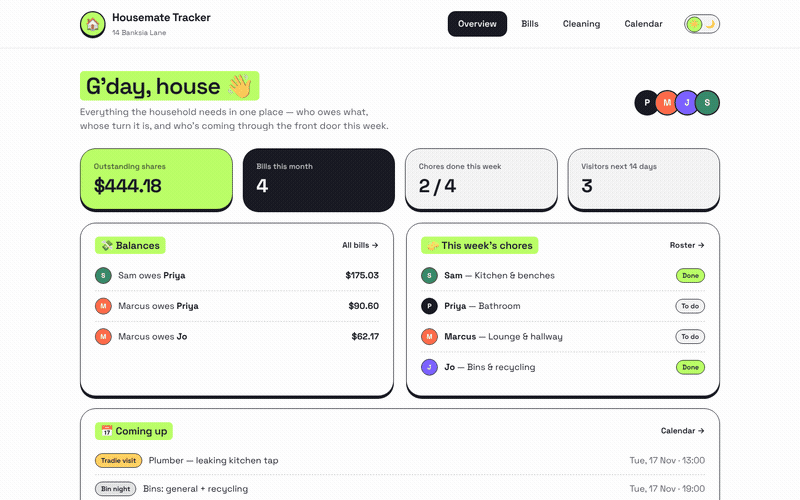
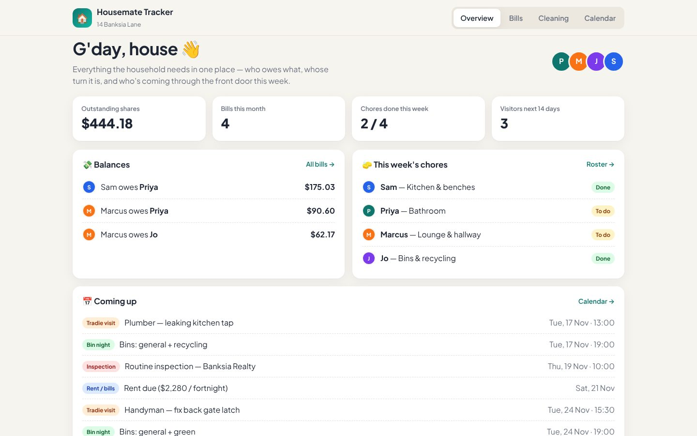
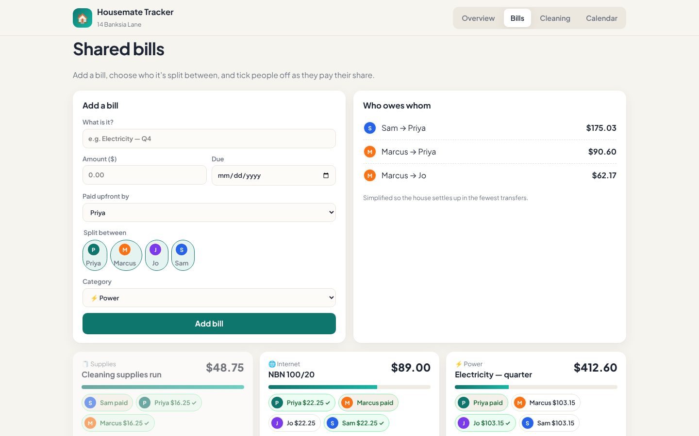
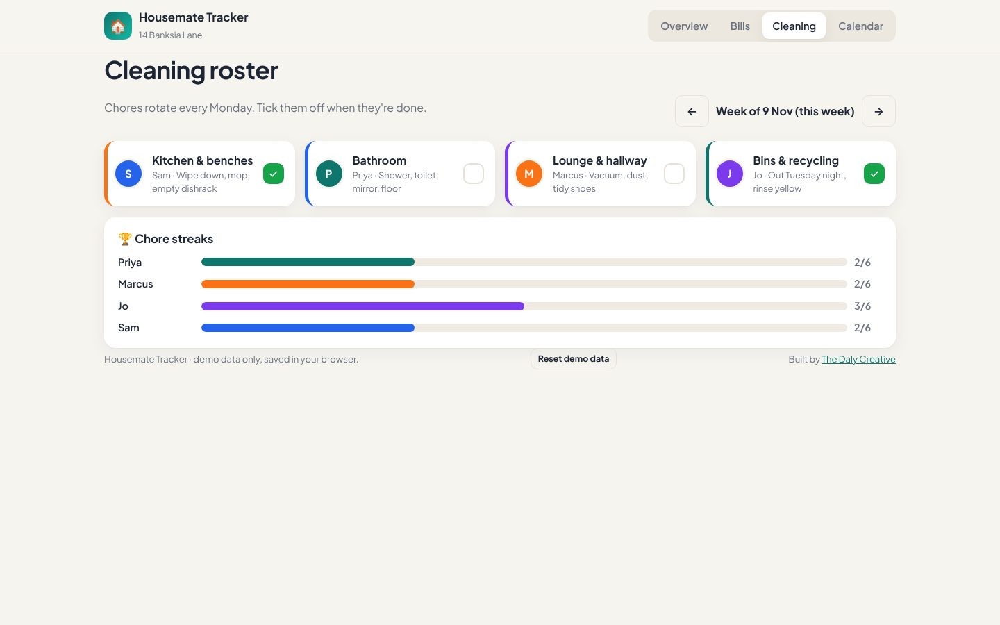
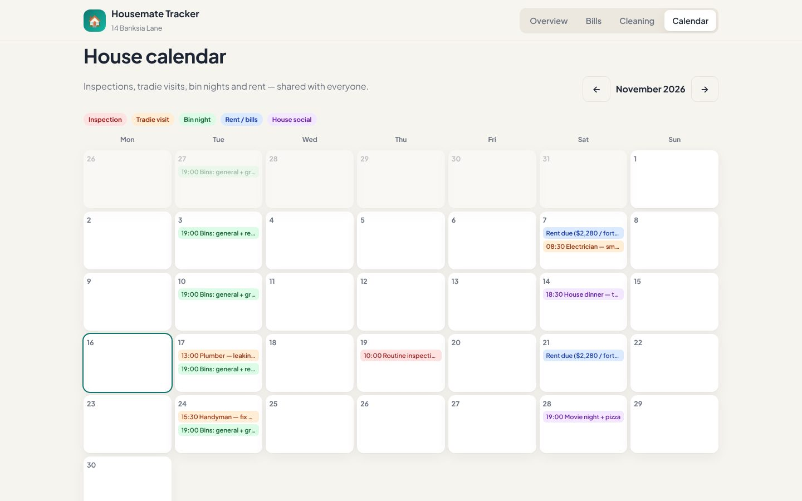
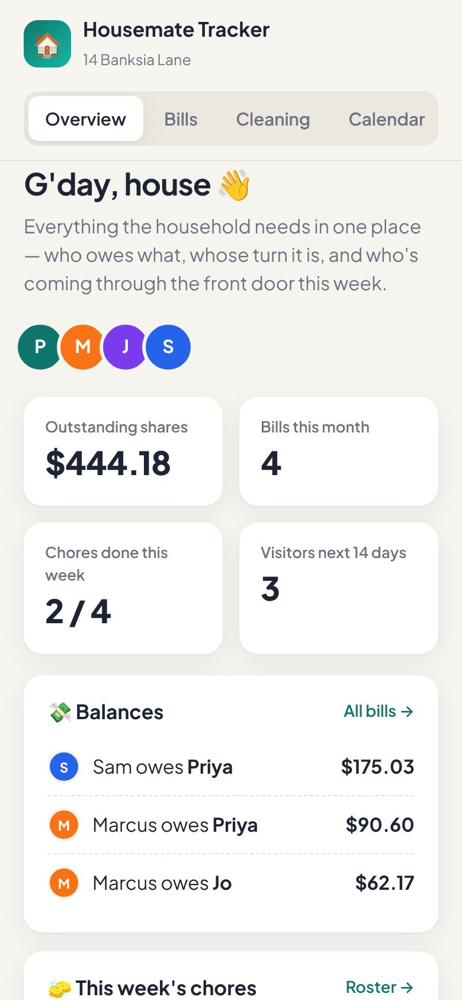

# Housemate Tracker

> Split shared bills, rotate the cleaning roster and keep inspections and tradie visits on one shared house calendar.

**Live demo:** [housemate-tracker.vercel.app](https://housemate-tracker.vercel.app)

    

## Features

- **Overview** — outstanding shares, chores done this week, upcoming visitors and who owes whom at a glance
- **Shared bills** — add a bill, choose who paid upfront and who it's split between, tick off each person's share; overdue bills are flagged
- **Settle up** — balances are simplified into the fewest possible transfers
- **Cleaning roster** — four chores rotate automatically every Monday; browse past/future weeks, tick chores off and see 6-week streaks
- **House calendar** — month view of inspections, handyman/tradie visits, bin nights, rent and house socials, with an add-event form
- Demo data is generated relative to today, saved in `localStorage`, and can be reset from the footer
- Accessible: skip link, live-region announcements, keyboard-friendly controls, responsive down to phones

## Tech stack

- Vanilla JavaScript (no framework, no build)
- Hand-written CSS with custom properties; Plus Jakarta Sans
- `localStorage` persistence
- Hosted on Vercel as a static site

## Run it locally

```bash
git clone https://github.com/thedalycreative/housemate-tracker.git
cd housemate-tracker
python3 -m http.server 8000   # or: npx serve .
# open http://localhost:8000
```

## Deployment (Vercel)

Static site — no build command, output directory is the repo root. The Vercel project **housemate-tracker** is linked to this repo and deploys `main` to production at **https://housemate-tracker.vercel.app**.

## Screenshots



<p align="center">
  
  
  
  
  
</p>

_Captured from the live site (https://housemate-tracker.vercel.app). Regenerate with any headless browser; files live in `docs/screenshots/`._

> All housemates, addresses and events in this demo are fictional.

---

Built by [The Daly Creative](https://www.thedalycreative.com) · Perth, WA
